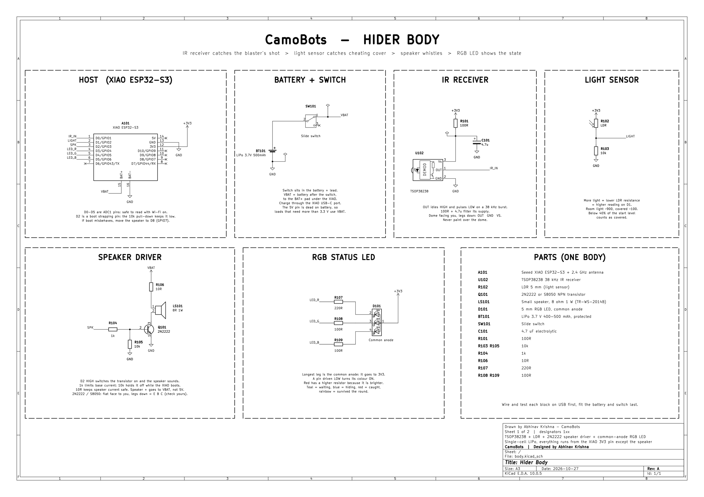
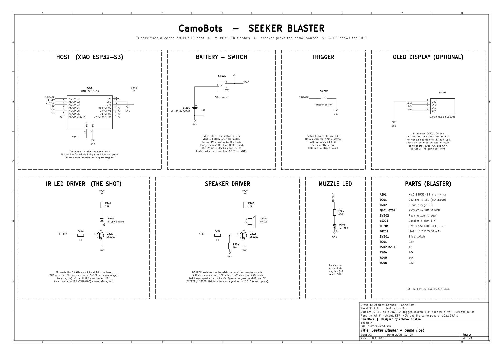

# CamoBots

A real-life paint-and-hide shooter game. Hiders paint small white robot bodies to blend into a room and hide them. The seeker hunts them down with an infrared blaster before time runs out.

Inspired by the game Meccha Chameleon. Not affiliated with it, and it uses none of its audio, art or logos.

## How it plays

1. **Hide:** a start tone and a green flash, then a timed countdown. Hiders paint and place their bodies. The blaster is locked.
2. **Hunt:** a bell rings on every device and the blaster goes live. The last 10 s tick down on the blaster. Bodies whistle every so often, giving away their position.
3. **Shoot:** an IR hit captures a body. A miss locks the trigger for a few seconds.
4. **Reveal:** surviving bodies whistle and flash a rainbow. Points are tallied. A random hider hunts next, unless a hider taps I'LL HUNT on their phone first. Only the new hunter and the old one trade: the new hunter hands their bot to the old one and takes the blaster.

Burying a body is not allowed. Each body has a light sensor, and a covered body whistles nonstop and loses points.

## Hardware

All boards are Seeed Studio XIAO ESP32-S3.

| Unit | Parts |
|---|---|
| Body (x2) | TSOP38238 IR receiver, LDR, speaker on an NPN driver, common-anode RGB LED, 400-500 mAh LiPo, slide switch |
| Blaster (x1) | 940 nm IR LED on a transistor, orange muzzle-flash LED, trigger button, speaker, optional 0.96" OLED, 2200 mAh Li-ion |

The optional OLED on the blaster runs arcade-style screens: a title and high scores between rounds, a hide countdown, then during the hunt a top bar with a figure for each hider (crossed out once caught) and the seeker's HP hearts, plus the timer and shots. After each capture it shows who was caught, the points earned and how many bodies are left. Two captures within 15 s show DOUBLE!, and the last body left gets its own alert. Power it from VBAT (the battery after the switch), since the 5V pin is dead on battery; on 3V3 it stays blank. If no OLED is wired, the blaster skips it.

Between rounds, pulling the trigger starts the next round once a body has joined. Holding the trigger for 3 s stops a round with no points scored. The game page can start and stop rounds too.

The blaster is also the game host. It runs a Wi-Fi hotspot called `CamoBots`, talks to the bodies over ESP-NOW on channel 1, and serves the game page at `http://192.168.4.1`.

### Schematics

Wiring for each unit is in [hardware/](hardware/), as KiCad files and PDFs:

- [Hider body](hardware/body.pdf)
- [Seeker blaster](hardware/blaster.pdf)




### Pin map

| Pin | GPIO | Body | Blaster |
|---|---|---|---|
| D0 | 1 | TSOP IR in | Trigger button |
| D1 | 2 | LDR | IR LED (38 kHz) |
| D2 | 3 | Speaker | Muzzle-flash LED |
| D3 | 4 | RGB red | Speaker |
| D4 / D5 | 5 / 6 | RGB green / blue | OLED SDA / SCL |

## Building

Uses [PlatformIO](https://platformio.org/). One firmware, built for each role:

```
pio run -e body    -t upload --upload-port COMx
pio run -e blaster -t upload --upload-port COMy
```

`body_sim` and `blaster_sim` build the same firmware with simulated sensors, so the game runs on bare boards with no parts wired.

In the SIM builds, type these into the serial monitor:

| Board | Commands |
|---|---|
| Blaster | `start`, `stop`, `fire`, `whistle N`, `set hide/hunt/whistle/reveal/lock/hp/strikes/cover/players/first N`, `name N TEXT`, `reset` (new session), `json`, `status` |
| Body | `hit [seeker]`, `scan N` (N seconds in the beam), `cover`, `uncover`, `dark`, `ldr N`, `status` |

The BOOT button fires on the blaster and counts as a hit on a body.

To test each part on its own, flash `bench_body` or `bench_blaster` and open the serial monitor. The body prints every IR frame it decodes, raw TSOP edges and the light level once a second. On the blaster the trigger fires a shot, `burst 20` fires 20 shots half a second apart, and `scan` toggles Missed Spot scans. On both, `snd N` plays a sound and `pix N` sets a light state.

Run the scoring tests on the PC with `pio test -e native`.

If an upload fails and the board keeps restarting, hold **BOOT** while plugging in the USB cable, then upload again.

## Game page

Join the `CamoBots` Wi-Fi and open `http://192.168.4.1`. The page is built into the blaster firmware, so it works with no internet.

- **Live:** timer, seeker HP and shots, one card per body with strikes, Missed Spot meter, signal and a whistle button, plus a kill feed.
- **Setup:** round times, seeker HP, cover strikes, player names and who hunts next. Saved on the blaster.
- **Hider:** each hider picks their bot on their own phone. Free and taken bots are shown, and one phone holds one bot. During the hunt a big TAUNT button blows the bot's whistle for +10 points, once every 15 s. Brave, because the seeker hears where it is. The phone stays silent during the hunt. Between rounds an I'LL HUNT! button lets a hider take the blaster next round. Setup has a FREE ALL BOTS button.
- **Scores:** session leaderboard, badges and the last round breakdown.
- **Big screen:** a large view for a laptop or TV while filming.

Open `web/index.html?mock` in any browser to try the page with a fake game. Tap a chameleon to spot it, press Space to fire.

## Scoring

| Who | Points |
|---|---|
| Hider | 1 per second survived (not while covered), +5 per second in the beam without being shot (Missed Spot), +100 if never found (Ghost), +50 for the sole survivor (Last Chameleon), -20 per cover strike |
| Seeker | 100 + seconds left per capture, +25 within 10 s of that body's whistle (Whistle Hunter), +100 for finding everyone (Clean Sweep) |

Badges over the session: Disguise (most survival), Sharpshooter (best accuracy), Eagle Ears (most Whistle Hunters), Cover Cheater (most cover strikes), Daredevil (most Missed Spot).

## Status

- [x] ESP-NOW link with the hotspot on one channel (0 lost packets, 10 m and 2 walls)
- [x] Full game logic with simulated sensors (hide, hunt, cover, strikes, misses, seeker HP, reveal)
- [x] Scoring, badges and session totals (saved on the blaster)
- [x] Game page
- [x] Lost hit and cover messages are repeated in the next check-in
- [x] IR, light sensor, speaker, RGB LED and OLED tested on real parts (full round with one body)

Bench numbers are in [docs/bench-results.md](docs/bench-results.md).

## License

MIT
